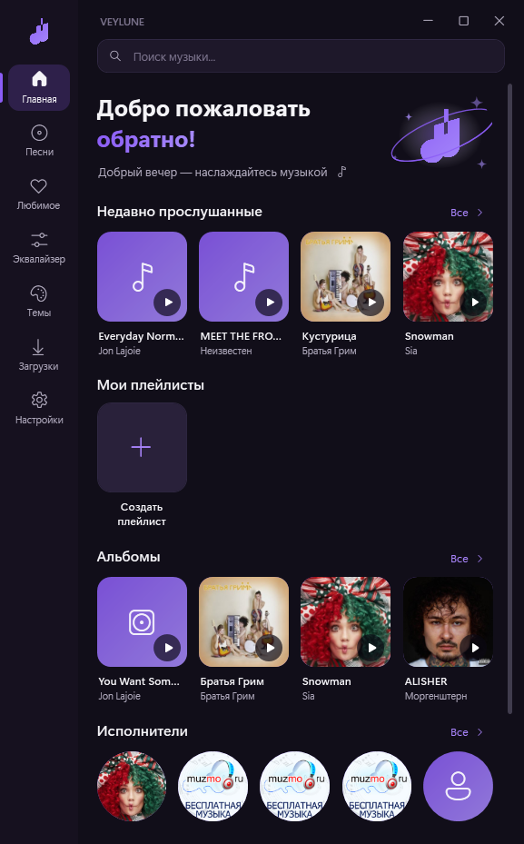
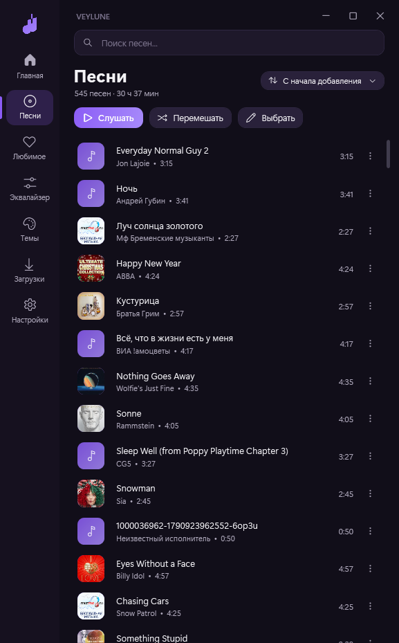
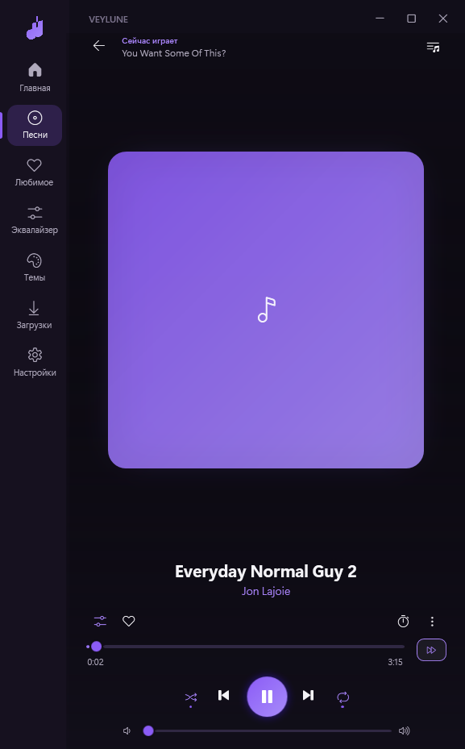
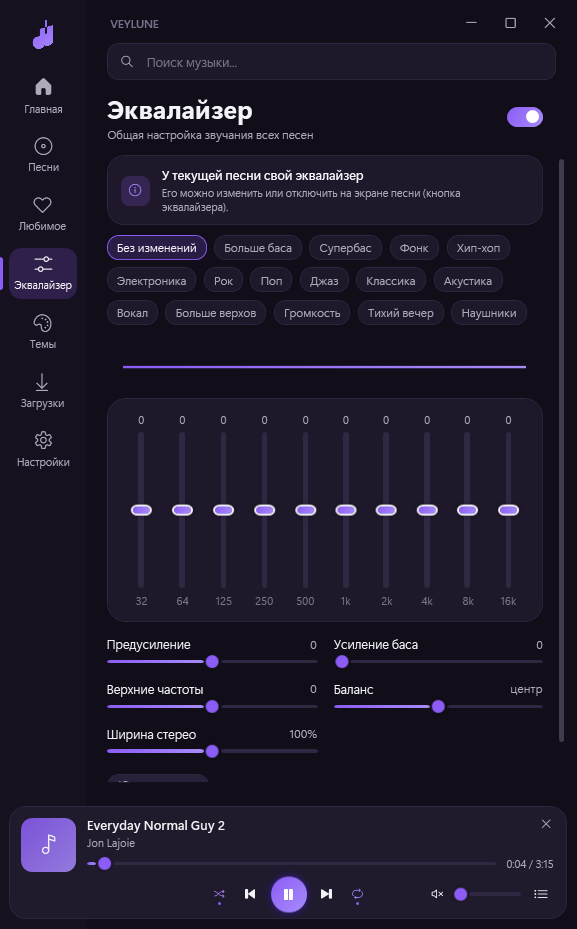
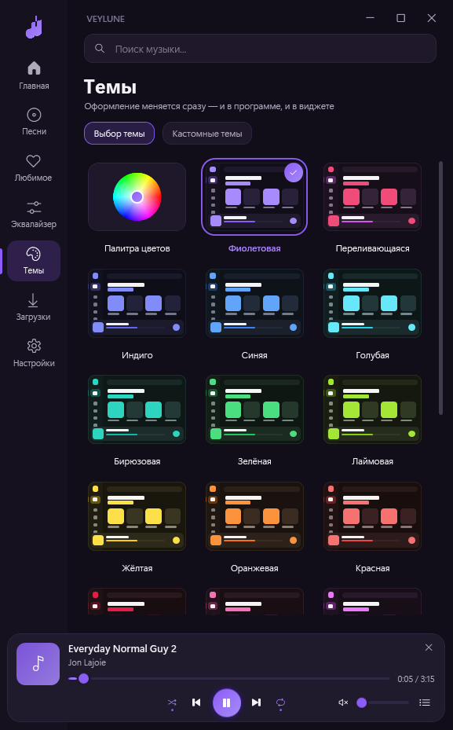

**Актуальная версия: 1.0.0**

[⬇️ Скачать последнюю версию Veylune](https://github.com/semka007129-usex/Veylune/releases/latest)

**Новые версии и обновления программы публикуются на странице** [GitHub Releases](https://github.com/semka007129-usex/Veylune/releases).

**Veylune распространяется на условиях авторской лицензии. Ознакомиться с полными условиями можно в файле** [LICENSE.txt](LICENSE.txt).

## 🎵 Veylune

**Твоя музыка. Твоё звучание. Твой стиль.**

**Veylune** — музыкальный плеер для Windows, в котором приятно слушать свою музыку. Без рекламы, подписок и интернета: добавьте песни с компьютера или телефона, и Veylune сам разложит их по альбомам и исполнителям, подтянет обложки и подстроит звук под ваш вкус.

## ✨ Почему Veylune

• **Вся музыка в одном месте.** Альбомы и исполнители собираются сами по тегам, обложки берутся из файлов. Одно имя в разных написаниях — один исполнитель.

• **Почти любые форматы.** MP3, FLAC, WAV, M4A, AAC, OGG, Opus (включая голосовые из WhatsApp и Telegram), WMA, AIFF и другие.

• **Музыка с телефона.** По Wi‑Fi через QR-код, по USB, по Bluetooth или из облака — без лишних программ.

• **Эквалайзер.** 10 полос, 16 готовых пресетов, усиление баса и верхов, баланс и ширина стерео. У каждой песни может быть свой эквалайзер.

• **Темы оформления.** 22 готовые темы — от фиолетовой до переливающейся, палитра цветов и свои темы из ваших картинок. Меняются сразу, без перезапуска.

• **Плейлисты и любимое.** Создавайте плейлисты, ставьте обложки, перетаскивайте песни. Удобные сортировки, поиск и выбор нескольких песен сразу.

• **Экран песни.** Крупная обложка с подсветкой в такт музыке, таймер сна, очередь и все действия с песней под рукой.

• **Виджет поверх окон.** Небольшой островок с обложкой и кнопками, подсвеченный в такт басам: управляйте музыкой, не открывая плеер.

• **Музыка в микрофон.** Включайте песни друзьям в игре или в звонке через виртуальный кабель *(экспериментальная функция)*.

• **Горячие клавиши, трей и автозапуск.** Плеер работает в фоне и всегда под рукой.

• **Русский и английский языки.** Интерфейс плавно подстраивается под любой размер окна.

## 💻 Установка

• Скачайте установщик (или архив с ним) и запустите его.

• Выберите язык, папку и ярлыки, примите лицензионное соглашение и нажмите «Установить».

• Запустите Veylune с рабочего стола или из меню «Пуск».

**Требования:** Windows 10 или 11 (64-бит). Права администратора и дополнительные загрузки не нужны — всё необходимое, включая .NET, уже внутри.

Если Windows покажет окно «Windows защитила ваш компьютер», нажмите «Подробнее» → «Выполнить в любом случае». Так система реагирует на новые программы без платной цифровой подписи.

Чтобы обновить программу, просто запустите новый установщик поверх старой версии — библиотека, плейлисты и настройки сохранятся.

*На Linux и других системах программа не проверялась!*

## 🛠️ Разработка и авторство

**Veylune** — независимый авторский проект, разрабатываемый **Semka Z**.

В процессе разработки используется **Claude Code** в качестве AI-инструмента для написания, анализа и улучшения программного кода.

**Концепция, постановка задач, проверка результатов, тестирование и развитие проекта осуществляются автором.**

## 🔄 Что дальше

**Veylune развивается.** В программу будут регулярно добавляться новые возможности, так что заходите сюда за обновлениями.

Если вы заметите ошибки при работе с программой, сообщите пожалуйста о них автору программы.

## 📬 Связь

**Автор/разработчик:** Semka Z. **Telegram:** @mrsemkaz · **Discord:** mrsemkaz · **Почта:** semka007129@gmail.com

## ❤️ Поддержать разработчика

Если вам нравится Veylune, вы можете поддержать его развитие:

[Поддержать Veylune на Boosty](https://boosty.to/mrsemkaz/donate)

[Поддержать разработчика напрямую](https://pay.cloudtips.ru/p/22fc577e)
